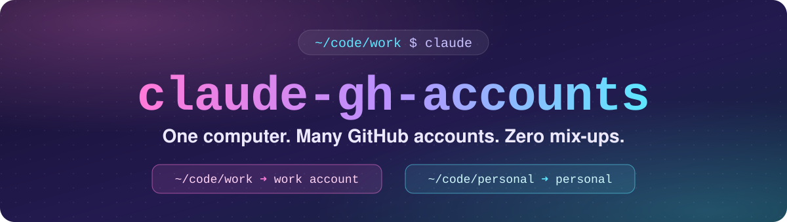
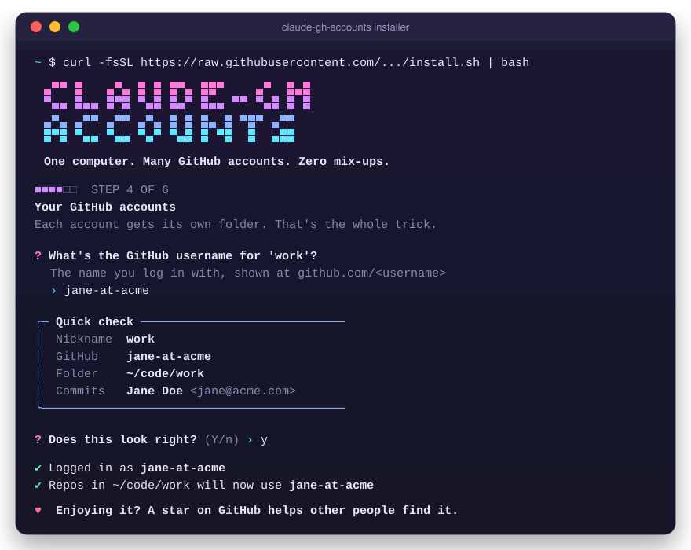
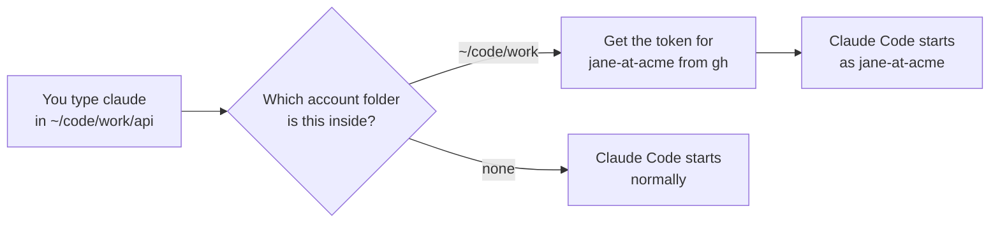

<h1 align="center">
  
</h1>

<p align="center">
  <b>Use several GitHub accounts with Claude Code. The right one is picked automatically for each folder.</b>
</p>

<p align="center">
  <a href="https://github.com/us-urvin/claude-gh-accounts/releases/latest"></a>
  <a href="https://github.com/us-urvin/claude-gh-accounts/releases/latest"></a>
  <a href="https://github.com/us-urvin/claude-gh-accounts/actions/workflows/ci.yml"></a>
  <a href="LICENSE"></a>
  
  <a href="https://github.com/us-urvin/claude-gh-accounts/stargazers"></a>
</p>

<p align="center">
  <a href="#-install-in-one-line">Install</a> &nbsp;&middot;&nbsp;
  <a href="#-how-it-works">How it works</a> &nbsp;&middot;&nbsp;
  <a href="#-faq">FAQ</a> &nbsp;&middot;&nbsp;
  <a href="#-uninstall">Uninstall</a>
</p>

---

## 🤔 The problem

You have a **work** GitHub account and a **personal** one, and maybe a few for clients. Your computer only remembers one at a time, so sooner or later:

- 😬 your personal project gets a commit with your work email,
- 🙈 a push to a client repo fails because you're logged in as someone else,
- 🤖 Claude Code opens a pull request from the wrong account.

## ✨ The fix

**claude-gh-accounts** gives every GitHub account **its own folder**. Work inside a folder and everything uses that folder's account, automatically:

```text
~/code/work/api        $ claude    ➜  GitHub account: jane-at-acme
~/code/personal/blog   $ claude    ➜  GitHub account: jane-dev
```

| | What happens |
| --- | --- |
| ✍️ **Commits** | Signed with the right name and email |
| 🔐 **Clone, pull, push** | Use the right account, over HTTPS **and SSH** (`git@github.com:...`) |
| 🤖 **Claude Code** | Starts as the right account, so pull requests and issues come from the right person |
| 🏠 **Everything else** | Projects outside these folders keep their usual settings |

No need to remember anything or switch accounts by hand.

> [!NOTE]
> **Built for the terminal.** It works with Claude Code in your terminal (macOS, Linux, Windows PowerShell and Command Prompt). Support for Claude Code on the web and in IDEs is **coming soon**. [Star or watch the repo](https://github.com/us-urvin/claude-gh-accounts) to hear about it.

## 🚀 Install in one line

Open a terminal, paste **one** line, and answer a few friendly questions.

**🍎 macOS / 🐧 Linux:** open the **Terminal** app and paste:

```bash
curl -fsSL https://github.com/us-urvin/claude-gh-accounts/releases/latest/download/install.sh | bash
```

**🪟 Windows:** first check which terminal you have, by how the line starts:

| Your terminal shows | You're in | Paste this |
| --- | --- | --- |
| `PS C:\Users\you>` | **PowerShell** | `irm https://github.com/us-urvin/claude-gh-accounts/releases/latest/download/install.ps1 \| iex` |
| `C:\Users\you>` (no **PS**) | **Command Prompt** | the longer command below |

**PowerShell:**

```powershell
irm https://github.com/us-urvin/claude-gh-accounts/releases/latest/download/install.ps1 | iex
```

**Command Prompt:**

```cmd
powershell -NoProfile -ExecutionPolicy Bypass -Command "irm https://github.com/us-urvin/claude-gh-accounts/releases/latest/download/install.ps1 | iex"
```

After installing, `claude` switches accounts in **both** Command Prompt and PowerShell.

> [!WARNING]
> On Windows, **don't** use the macOS / Linux `curl ... | bash` command. `bash` there opens the Linux subsystem (WSL), which fails with *"Windows Subsystem for Linux has no installed distributions"*.

It takes about **3 minutes**. The installer walks you through everything:

<p align="center">
  
</p>

1. It installs anything missing (Git, GitHub CLI, Claude Code).
2. For each account it asks which **GitHub account** (suggesting ones you're already logged in to), a **nickname** and a **folder**. Your **name and email** are filled in from your GitHub profile.
3. It shows a **quick check** so you can confirm, then opens your browser to log in.
4. If your projects use SSH addresses, it sets up an SSH key for that account too (optional).
5. Done! **Open a new terminal window**, go into an account folder and type `claude`.

> [!TIP]
> When the browser opens to log in, make sure it's signed in to the **right** GitHub account. If it isn't, sign out on github.com first, or paste the login link into a private/incognito window.

<details>
<summary><b>Prefer to read the script before running it?</b> (recommended for the security-minded)</summary>

```bash
curl -fsSLO https://github.com/us-urvin/claude-gh-accounts/releases/latest/download/install.sh
less install.sh
bash install.sh
```

```powershell
irm https://github.com/us-urvin/claude-gh-accounts/releases/latest/download/install.ps1 -OutFile install.ps1
notepad install.ps1
powershell -ExecutionPolicy Bypass -File .\install.ps1
```
</details>

## ✅ Check it's working

```bash
cd ~/code/work/some-project
claude                         # prints "GitHub account: <your work username>"
git config user.email          # prints your work email
```

Want to add another account or move one to a different folder? **Just run the installer again.** It remembers everything: accounts you've set up are pre-filled, accounts already logged in on your computer are suggested, and a new account's name and email come from its GitHub profile. Most answers are just <kbd>Enter</kbd>.

## 🧠 How it works



<details>
<summary><b>The technical details</b></summary>

1. **Installs what's missing:** Git, GitHub CLI (2.40+, which supports several logged-in accounts) and Claude Code (official installer). It uses Homebrew, apt, dnf, pacman, zypper or winget.
2. **Logs in each account** with `gh auth login`. Tokens stay in gh's secure storage (macOS Keychain, Windows Credential Manager or the Linux keyring). This tool never writes them to disk.
3. **Configures git per folder:** it adds an `includeIf "gitdir/i:<folder>/"` entry to `~/.gitconfig` that loads `~/.gitconfig-<nickname>`. That file holds the commit identity and a credential helper that asks gh for that account's token. The entries are kept at the end of `~/.gitconfig` so they win inside the folders, while gh's own git setting stays in place for everything else.
4. **SSH (optional):** for accounts that use `git@github.com:` addresses, it creates a key (`~/.ssh/claude-gh-<nickname>`) or uses yours, trusts GitHub's official host fingerprints, adds the key to the right GitHub account with your OK, and checks GitHub recognises it as that account. The folder's config then sets `core.sshCommand` to use that key. No `~/.ssh/config` host aliases, and no changes to your remotes.
5. **Adds a small `claude` function** to your shell profile. It finds the longest matching folder in `~/.claude-gh-accounts` and starts Claude Code with that account's `GH_TOKEN`. On Windows, a `claude.cmd` placed at the front of your user `PATH` does the same in Command Prompt.
6. **Prevents common push errors:** new logins include the `workflow` permission (needed to push GitHub Actions files), existing logins are checked and fixed with your OK, and if GitHub ever rejects a saved login, git prints a hint with the fix.

| File | Purpose |
| --- | --- |
| `~/.claude-gh-accounts` | `folder\|github-user\|nickname` list used by the `claude` function |
| `~/.gitconfig-<nickname>` | Commit identity, credential helper and (with SSH) `core.sshCommand` for one account |
| `~/.ssh/claude-gh-<nickname>`, `.pub` | The account's SSH key, only if you chose SSH and let the installer create one |
| `~/.ssh/known_hosts` | GitHub's official host fingerprints, added once if missing (SSH only) |
| `~/.gitconfig` | One `includeIf` line per account |
| `~/.zshrc`, `~/.bashrc`, `~/.bash_profile` | The `claude` function, between `# >>> claude-gh-accounts >>>` markers |
| `Documents\PowerShell\profile.ps1`, `Documents\WindowsPowerShell\profile.ps1` | The same function for PowerShell |
| `%LOCALAPPDATA%\claude-gh-accounts\bin` (added to your user `PATH`) | `claude.cmd` and its helper, for Command Prompt |

</details>

## 🧰 Troubleshooting

**First, check which account a project is using.** Run these inside the project folder:

```bash
git config user.email      # should be this account's email
gh auth status             # lists your logged-in accounts
git remote -v              # should start with https://github.com/
```

If the email is wrong, the project isn't inside an account folder. Move it there, or run the installer again to add the folder.

### Common push errors

| You see | What it means | Fix |
| --- | --- | --- |
| `refusing to allow an OAuth App to create or update workflow ... without workflow scope` | Your login isn't allowed to change GitHub Actions files (`.github/workflows`). | `gh auth switch --user <you>`, then `gh auth refresh -h github.com -s workflow`. Or run the installer again, which offers to fix it. |
| `Permission to OWNER/REPO.git denied to <other-user>` or `403` | Git used a different account than the one with access. | Check `git config user.email` (see above) and make sure the project is inside the right account folder. Over SSH, also see the next row. |
| `Permission denied (publickey)` or `ERROR: Permission to ... denied to <other-user>` over SSH | No key for this account, or the key belongs to another account. | Run the installer again and answer **yes** to the SSH question for this account. Check with `git config core.sshCommand` inside the project. |
| `Repository not found` | The repo is private and this account can't see it, or it's the wrong account. | Same as above. Also check on github.com that this account has access to the repo. |
| `Authentication failed` or `GitHub did not accept the saved login for <you>` | The saved login expired or was revoked. | `gh auth login` and sign in as that account again. |
| `GH006: Protected branch update failed` or `Changes must be made through a pull request` | The branch is protected. | Push to a new branch and open a pull request: `git switch -c my-change`, `git push -u origin my-change`, `gh pr create`. |
| `! [rejected] main -> main (fetch first)` or `non-fast-forward` | GitHub has commits you don't have yet. | `git pull --rebase`, then push again. |
| `'irm' is not recognized` (Windows) | You're in Command Prompt, not PowerShell. | Use the [Command Prompt install command](#-install-in-one-line). |
| `Windows Subsystem for Linux has no installed distributions` | You ran the macOS / Linux `curl ... \| bash` command on Windows. | Use the [Windows install command](#-install-in-one-line) for your terminal. |

Still stuck? [Open an issue](https://github.com/us-urvin/claude-gh-accounts/issues/new/choose) and paste the error. Remove any tokens or emails first.

## ❓ FAQ

<details>
<summary><b>Does it work with Claude Code on the web, the VS Code / JetBrains extension or the desktop app?</b></summary>

Not fully yet. It's built for Claude Code in the terminal. In IDEs and the desktop app, commits, pulls and pushes still use the right account (git handles that), but Claude Code's own GitHub actions, like opening pull requests, only switch when you start `claude` from a terminal. Support for the web and IDEs is coming soon.
</details>

<details>
<summary><b>Does it work with SSH addresses (<code>git@github.com:...</code>)?</b></summary>

Yes. Answer **yes** to the SSH question for an account and the installer sets up a key for it, or uses yours. Inside that account's folder, git then uses that key for `git@github.com:` addresses, including `git clone`. HTTPS addresses keep working too.
</details>

<details>
<summary><b>Will it change how my other projects work?</b></summary>

No. Projects outside the account folders keep their usual settings, including GitHub CLI's own git login if you use it. Inside an account folder, that account's settings take priority.
</details>

<details>
<summary><b>The browser logged me in as the wrong account.</b></summary>

GitHub logs you in as whoever is signed in to your browser. Sign out on github.com first, or paste the login link into a private window. The installer notices the mix-up and offers to try again.
</details>

<details>
<summary><b>Windows says running scripts is disabled.</b></summary>

The installer allows PowerShell to load your profile (`RemoteSigned`, for your user only). If your company blocks that, the installer tells you. Ask IT, or start Claude Code with `claude.exe`. Git switching still works either way.
</details>

<details>
<summary><b>Is it safe?</b></summary>

Yes. The scripts are short, open and tested on every change. Your logins stay in GitHub CLI's secure storage, and the installer only changes the files listed above. Read [SECURITY.md](SECURITY.md) for details, or read the script first (see the install section above).
</details>

## 🧹 Uninstall

1. Delete the block between `# >>> claude-gh-accounts >>>` and `# <<< claude-gh-accounts <<<` in your shell profile(s).
2. Remove the `includeIf` lines from `~/.gitconfig` (`git config --global --edit`).
3. Delete `~/.claude-gh-accounts` and the `~/.gitconfig-<nickname>` files.
4. Windows only: delete `%LOCALAPPDATA%\claude-gh-accounts`, remove it from your user `PATH` (Start → "Edit environment variables for your account"), and remove the `cmd-autorun.cmd` entry from `AutoRun` under `HKEY_CURRENT_USER\Software\Microsoft\Command Processor` (Registry Editor).
5. SSH only: delete `~/.ssh/claude-gh-<nickname>` and `.pub`, and remove the key at https://github.com/settings/keys.
6. Optional: `gh auth logout --user <name>` for accounts you no longer need.

## 🤝 Contributing

Ideas, bug reports and pull requests are welcome! See [CONTRIBUTING.md](CONTRIBUTING.md). Please report security issues privately as described in [SECURITY.md](SECURITY.md).

## ⭐ Support the project

If this saved you from pushing with the wrong account, please **[give it a star](https://github.com/us-urvin/claude-gh-accounts)**. It helps other people find it.

<p align="center">
  <a href="https://github.com/us-urvin/claude-gh-accounts/stargazers"></a>
</p>

---

<p align="center">
  <sub><a href="LICENSE">MIT License</a> &middot; Community project, not affiliated with Anthropic or GitHub. "Claude" is a trademark of Anthropic.</sub>
</p>
