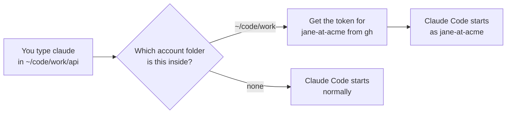

<h1 align="center">
  
</h1>

<p align="center">
  <b>Use several GitHub accounts with Claude Code. The right one is picked automatically for each folder.</b>
</p>

<p align="center">
  <a href="https://github.com/us-urvin/claude-gh-accounts/actions/workflows/ci.yml"></a>
  <a href="LICENSE"></a>
  
  <a href="https://github.com/us-urvin/claude-gh-accounts/stargazers"></a>
</p>

<p align="center">
  <a href="#-install-in-one-line">Install</a> &nbsp;&middot;&nbsp;
  <a href="#-how-it-works">How it works</a> &nbsp;&middot;&nbsp;
  <a href="#-faq">FAQ</a> &nbsp;&middot;&nbsp;
  <a href="#-uninstall">Uninstall</a>
</p>

---

## 🤔 The problem

You have a **work** GitHub account and a **personal** one, and maybe a few for clients. Your computer only remembers one at a time, so sooner or later:

- 😬 your personal project gets a commit with your work email,
- 🙈 a push to a client repo fails because you're logged in as someone else,
- 🤖 Claude Code opens a pull request from the wrong account.

## ✨ The fix

**claude-gh-accounts** gives every GitHub account **its own folder**. Work inside a folder and everything uses that folder's account, automatically:

```text
~/code/work/api        $ claude    ➜  GitHub account: jane-at-acme
~/code/personal/blog   $ claude    ➜  GitHub account: jane-dev
```

| | What happens |
| --- | --- |
| ✍️ **Commits** | Signed with the right name and email |
| 🔐 **Clone, pull, push** | Use the right account's login |
| 🤖 **Claude Code** | Starts as the right account, so pull requests and issues come from the right person |
| 🏠 **Everything else** | Projects outside these folders work exactly like before |

No need to remember anything or switch accounts by hand.

## 🚀 Install in one line

Open a terminal, paste **one** line, and answer a few friendly questions.

**🍎 macOS / 🐧 Linux:** open the **Terminal** app and paste:

```bash
curl -fsSL https://raw.githubusercontent.com/us-urvin/claude-gh-accounts/main/install.sh | bash
```

**🪟 Windows:** open **PowerShell** (press <kbd>Win</kbd>, type `PowerShell`, press <kbd>Enter</kbd>) and paste:

```powershell
irm https://raw.githubusercontent.com/us-urvin/claude-gh-accounts/main/install.ps1 | iex
```

<details>
<summary>Using <b>Command Prompt</b> (<code>cmd</code>) instead? Getting <i>"'irm' is not recognized"</i>?</summary>

`irm` only works in PowerShell. In Command Prompt, paste this instead:

```cmd
powershell -NoProfile -ExecutionPolicy Bypass -Command "irm https://raw.githubusercontent.com/us-urvin/claude-gh-accounts/main/install.ps1 | iex"
```

After installing, start `claude` from a **PowerShell** window to get automatic account switching. Git (commits, push, pull) switches accounts in Command Prompt too.
</details>

It takes about **3 minutes**. The installer walks you through everything:

<p align="center">
  
</p>

1. It installs anything missing (Git, GitHub CLI, Claude Code).
2. For each account it asks for a **nickname**, the **GitHub username**, a **folder**, and your **name and email**.
3. It shows a **quick check** so you can confirm, then opens your browser to log in.
4. Done! **Open a new terminal window**, go into an account folder and type `claude`.

> [!TIP]
> When the browser opens to log in, make sure it's signed in to the **right** GitHub account. If it isn't, sign out on github.com first, or paste the login link into a private/incognito window.

<details>
<summary><b>Prefer to read the script before running it?</b> (recommended for the security-minded)</summary>

```bash
curl -fsSLO https://raw.githubusercontent.com/us-urvin/claude-gh-accounts/main/install.sh
less install.sh
bash install.sh
```

```powershell
irm https://raw.githubusercontent.com/us-urvin/claude-gh-accounts/main/install.ps1 -OutFile install.ps1
notepad install.ps1
powershell -ExecutionPolicy Bypass -File .\install.ps1
```
</details>

## ✅ Check it's working

```bash
cd ~/code/work/some-project
claude                         # prints "GitHub account: <your work username>"
git config user.email          # prints your work email
```

Want to add another account or move one to a different folder? **Just run the installer again.**

## 🧠 How it works



<details>
<summary><b>The technical details</b></summary>

1. **Installs what's missing:** Git, GitHub CLI (2.40+, which supports several logged-in accounts) and Claude Code (official installer). It uses Homebrew, apt, dnf, pacman, zypper or winget.
2. **Logs in each account** with `gh auth login`. Tokens stay in gh's secure storage (macOS Keychain, Windows Credential Manager or the Linux keyring). This tool never writes them to disk.
3. **Configures git per folder:** it adds an `includeIf "gitdir/i:<folder>/"` entry to `~/.gitconfig` that loads `~/.gitconfig-<nickname>`. That file holds the commit identity and a credential helper that asks gh for that account's token.
4. **Adds a small `claude` function** to your shell profile. It finds the longest matching folder in `~/.claude-gh-accounts` and starts Claude Code with that account's `GH_TOKEN`.

| File | Purpose |
| --- | --- |
| `~/.claude-gh-accounts` | `folder\|github-user\|nickname` list used by the `claude` function |
| `~/.gitconfig-<nickname>` | Commit identity and credential helper for one account |
| `~/.gitconfig` | One `includeIf` line per account |
| `~/.zshrc`, `~/.bashrc`, `~/.bash_profile` | The `claude` function, between `# >>> claude-gh-accounts >>>` markers |
| `Documents\PowerShell\profile.ps1`, `Documents\WindowsPowerShell\profile.ps1` | The same function for PowerShell |

</details>

## ❓ FAQ

<details>
<summary><b>Does it work with the VS Code / JetBrains extension or the Claude desktop app?</b></summary>

Partly. Commits, pulls and pushes use the right account everywhere, because git itself handles that. The account switch for Claude Code's own GitHub actions (like opening pull requests) happens when you start `claude` from a terminal, since IDEs and the desktop app don't go through your terminal's setup.
</details>

<details>
<summary><b>What about SSH remotes (<code>git@github.com:...</code>)?</b></summary>

Only HTTPS remotes are switched. SSH remotes keep using your SSH keys as before. To switch a project to HTTPS: `git remote set-url origin https://github.com/OWNER/REPO.git`.
</details>

<details>
<summary><b>The browser logged me in as the wrong account.</b></summary>

GitHub logs you in as whoever is signed in to your browser. Sign out on github.com first, or paste the login link into a private window. The installer notices the mix-up and offers to try again.
</details>

<details>
<summary><b>Windows says running scripts is disabled.</b></summary>

The installer allows PowerShell to load your profile (`RemoteSigned`, for your user only). If your company blocks that, the installer tells you. Ask IT, or start Claude Code with `claude.exe`. Git switching still works either way.
</details>

<details>
<summary><b>Is it safe?</b></summary>

Yes. The scripts are short, open and tested on every change. Your logins stay in GitHub CLI's secure storage, and the installer only changes the files listed above. Read [SECURITY.md](SECURITY.md) for details, or read the script first (see the install section above).
</details>

## 🧹 Uninstall

1. Delete the block between `# >>> claude-gh-accounts >>>` and `# <<< claude-gh-accounts <<<` in your shell profile(s).
2. Remove the `includeIf` lines from `~/.gitconfig` (`git config --global --edit`).
3. Delete `~/.claude-gh-accounts` and the `~/.gitconfig-<nickname>` files.
4. Optional: `gh auth logout --user <name>` for accounts you no longer need.

## 🤝 Contributing

Ideas, bug reports and pull requests are welcome! See [CONTRIBUTING.md](CONTRIBUTING.md). Please report security issues privately as described in [SECURITY.md](SECURITY.md).

## ⭐ Support the project

If this saved you from pushing with the wrong account, please **[give it a star](https://github.com/us-urvin/claude-gh-accounts)**. It helps other people find it.

<p align="center">
  <a href="https://github.com/us-urvin/claude-gh-accounts/stargazers"></a>
</p>

---

<p align="center">
  <sub><a href="LICENSE">MIT License</a> &middot; Community project, not affiliated with Anthropic or GitHub. "Claude" is a trademark of Anthropic.</sub>
</p>
