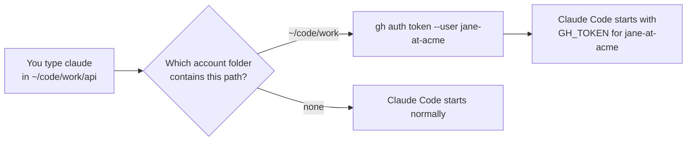

<div align="center">

# claude-gh-accounts

**Use several GitHub accounts with Claude Code. The right one is picked automatically for each folder.**

[](https://github.com/us-urvin/claude-gh-accounts/actions/workflows/ci.yml)
[](LICENSE)

[](https://github.com/us-urvin/claude-gh-accounts/stargazers)

</div>

```text
~/code/work/api        $ claude    ->  GitHub account: jane-at-acme
~/code/personal/blog   $ claude    ->  GitHub account: jane-dev
```

You have a work GitHub account and a personal one (maybe a few client accounts too). Claude Code, `git` and `gh` only know about one at a time, so commits, pushes and pull requests end up under the wrong name.

**claude-gh-accounts** gives each account its own folder. Everything inside that folder uses that account:

- **Commits** carry the right name and email.
- **Clone, pull and push** use the right account's credentials.
- **Claude Code** starts with the right `GH_TOKEN`, so `gh pr create`, `gh issue list` and similar commands run as the right account.
- Repos **outside** these folders work exactly as before.

## Install

**macOS / Linux**

```bash
curl -fsSL https://raw.githubusercontent.com/us-urvin/claude-gh-accounts/main/install.sh | bash
```

**Windows (PowerShell)**

```powershell
irm https://raw.githubusercontent.com/us-urvin/claude-gh-accounts/main/install.ps1 | iex
```

The installer asks a few simple questions for each account: a short name, the GitHub username, a folder, and the name and email to commit with. It then opens the browser so you can log in. When it's done, **open a new terminal**, `cd` into an account folder and type `claude`.

<details>
<summary>Prefer to read the script before running it?</summary>

```bash
curl -fsSLO https://raw.githubusercontent.com/us-urvin/claude-gh-accounts/main/install.sh
less install.sh
bash install.sh
```

```powershell
irm https://raw.githubusercontent.com/us-urvin/claude-gh-accounts/main/install.ps1 -OutFile install.ps1
notepad install.ps1
powershell -ExecutionPolicy Bypass -File .\install.ps1
```
</details>

## How it works



1. **Installs what's missing:** Git, GitHub CLI (2.40+, which supports several logged-in accounts) and Claude Code (official installer). It uses Homebrew, apt, dnf, pacman, zypper or winget.
2. **Logs in each account** with `gh auth login`. Tokens stay in gh's secure storage (Keychain, Credential Manager or the Linux keyring).
3. **Configures git per folder.** It adds an `includeIf "gitdir/i:<folder>/"` entry to `~/.gitconfig` that loads `~/.gitconfig-<name>`. That file holds the commit identity and a credential helper that asks gh for that account's token.
4. **Adds a small `claude` function** to your shell profile. It finds the longest matching folder in `~/.claude-gh-accounts` and starts Claude Code with that account's `GH_TOKEN`.

Run the installer again any time to **add an account**, **move an account to another folder**, or **change a name or email**.

## Check it's working

```bash
cd ~/code/work/some-repo
git config user.email          # the work email
claude                          # prints "GitHub account: <work username>"
```

Inside Claude Code, ask it to run `gh api user --jq .login`.

## Files it touches

| File | Purpose |
| --- | --- |
| `~/.claude-gh-accounts` | `folder\|github-user\|label` map used by the `claude` function |
| `~/.gitconfig-<label>` | Per-account commit identity and credential helper |
| `~/.gitconfig` | One `includeIf` entry per account |
| `~/.zshrc`, `~/.bashrc`, `~/.bash_profile` | `claude` function, between `# >>> claude-gh-accounts >>>` markers |
| `Documents\PowerShell\profile.ps1`, `Documents\WindowsPowerShell\profile.ps1` | Same function for PowerShell |

## FAQ

<details>
<summary>Does it work with the VS Code / JetBrains extension or the desktop app?</summary>

Partly. Plain `git` (commits, push, pull) uses the right account everywhere, because that's handled by git itself. The `GH_TOKEN` switch for `gh` commands only happens when you start `claude` from a terminal, since IDEs and the desktop app don't go through your shell.
</details>

<details>
<summary>What about SSH remotes (git@github.com:...)?</summary>

Only HTTPS remotes are switched. SSH remotes keep using your SSH keys as before. To switch an existing repo to HTTPS: `git remote set-url origin https://github.com/OWNER/REPO.git`.
</details>

<details>
<summary>The browser logged me in as the wrong account.</summary>

GitHub uses whichever account is signed in to your browser. Sign out on github.com first, or paste the login link into a private window. The installer notices the mismatch and offers to try again.
</details>

<details>
<summary>Windows says running scripts is disabled.</summary>

The installer sets the execution policy to `RemoteSigned` for your user, so your profile can load. If your company blocks that, the installer tells you. Ask IT, or start Claude Code with `claude.exe` (git switching still works).
</details>

## Uninstall

1. Delete the block between `# >>> claude-gh-accounts >>>` and `# <<< claude-gh-accounts <<<` in your shell profile(s).
2. Remove the `includeIf` entries from `~/.gitconfig` (`git config --global --edit`).
3. Delete `~/.claude-gh-accounts` and the `~/.gitconfig-<label>` files.
4. Optional: `gh auth logout --user <name>` for accounts you no longer need.

## Contributing

Issues and pull requests are welcome. See [CONTRIBUTING.md](CONTRIBUTING.md). Report security issues privately as described in [SECURITY.md](SECURITY.md).

## Support the project

If this saved you from pushing with the wrong account, please **[give it a star](https://github.com/us-urvin/claude-gh-accounts)**. It helps other people find it.

## License

[MIT](LICENSE). This is a community project, not affiliated with Anthropic or GitHub. "Claude" is a trademark of Anthropic.
